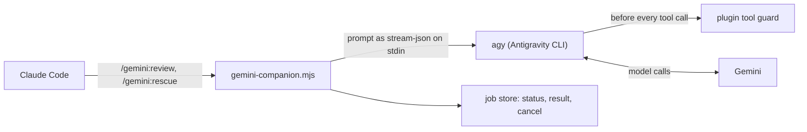

# Gemini plugin for Claude Code

[](https://github.com/azixxxxx/gemini-plugin-cc/actions/workflows/ci.yml)
[](https://github.com/azixxxxx/gemini-plugin-cc/releases)
[](LICENSE)
[](https://code.claude.com/docs/en/plugins)

**Use Google Gemini inside Claude Code.** This plugin adds `/gemini:review`, `/gemini:adversarial-review`, and `/gemini:rescue` to [Claude Code](https://code.claude.com/docs/en/overview), so Claude can get a second-opinion code review from Gemini, or hand Gemini a bug to investigate or fix, while you keep working. Gemini runs through Google's [Antigravity CLI](https://antigravity.google/download) (`agy`), which works with personal Google accounts.

It is a fork of [**openai/codex-plugin-cc**](https://github.com/openai/codex-plugin-cc), OpenAI's official plugin for using Codex from Claude Code. The commands, the background job model, and the stop-time review gate come from OpenAI's plugin; the runtime underneath is rebuilt for Gemini.

> [!NOTE]
> This is an unofficial community project. It is not affiliated with or endorsed by Google, Anthropic, or OpenAI. Product names are trademarks of their owners.

## Features

| Command | What it does |
| --- | --- |
| `/gemini:review` | Read-only Gemini code review of your uncommitted changes or your branch, with findings ordered by severity |
| `/gemini:adversarial-review` | Steerable review that challenges the design, the assumptions, and the failure modes of a change |
| `/gemini:rescue` | Hands an investigation or a fix to Gemini through the `gemini:gemini-rescue` subagent |
| `/gemini:status`, `/gemini:result`, `/gemini:cancel` | Track, read, and stop background Gemini jobs |
| `/gemini:setup` | Checks agy, the sign-in, the sandbox, and the tool guard, and toggles the optional review gate |

Why use it:

- **A second opinion from another model family**, without leaving Claude Code or copying diffs around.
- **Enforced read-only reviews.** A per-run tool guard limits reviews to reading files in your repository; it is not just an instruction in the prompt.
- **Safe delegation.** Gemini can edit files in your working tree, but the guard blocks `git commit`, `git push`, and edits outside the repository.
- **Background jobs** with status, results, cancel, and resume, the same workflow as OpenAI's Codex plugin.
- **An optional review gate** that has Gemini review Claude's last turn before Claude Code stops.

## Quick start

1. Install the Antigravity CLI. Google's [Gemini desktop app](https://gemini.google/desktop/) bundles it (on macOS at `/Applications/Gemini.app/Contents/Helpers/agy`), or install it on its own from [antigravity.google/download](https://antigravity.google/download).
2. Sign in once: run `agy` in a terminal, type `/login`, finish the sign-in in the browser, and quit with Ctrl+C twice.
3. In Claude Code, add the marketplace, install the plugin, and check the setup:

```bash
/plugin marketplace add azixxxxx/gemini-plugin-cc
/plugin install gemini@gemini-cc
/reload-plugins
/gemini:setup
```

4. Ask Gemini for a review of your current changes:

```bash
/gemini:review
```

## Requirements

- **The Antigravity CLI `agy`.** The plugin looks for it on your `PATH`, in the Gemini app bundle, and in `~/.local/bin`, where the standalone installer puts it. Set `GEMINI_COMPANION_AGY_PATH` to use another binary. Tested with agy 1.3.5.
- **An agy sign-in** with a Google account that can use Antigravity. Usage counts against the quota of that account.
- **Node.js 18.18 or later.** CI runs the tests on Node.js 18.18, 20, 22, 24, and 26.
- macOS is the tested platform. The test suite also runs on Linux in CI, but real agy runs on Linux are not verified yet. Windows is untested, and the plugin's tool guard is off there.

## Install

The Quick start covers the usual install. To work from a local clone instead, pass its path: `/plugin marketplace add /path/to/gemini-plugin-cc`.

`/gemini:setup` checks Node.js, the agy version and the flags the plugin needs, and whether Gemini answers, by sending one tiny read-only prompt.

If agy is installed but not signed in, open a terminal, run `agy`, type `/login`, finish the sign-in in the browser, and quit with Ctrl+C twice. Signing in needs an interactive terminal, so do it outside Claude Code. If Antigravity rejects the account or its location, sign in with another account or from a location where Antigravity is available.

After install, you should see:

- the slash commands listed above
- the `gemini:gemini-rescue` subagent in `/agents`

One simple first run is:

```bash
/gemini:review --background
/gemini:status
/gemini:result
```

## Usage

### `/gemini:review`

Runs a read-only Gemini review of your current work and returns a verdict with findings ordered by severity.

Use it when you want:

- a review of your current uncommitted changes
- a review of your branch compared to a base branch like `main`

Use `--base <ref>` for branch review, `--model` to pick a model, and `--effort` to set the reasoning effort. It also supports `--wait` and `--background`. It is not steerable and does not take custom focus text. Use [`/gemini:adversarial-review`](#geminiadversarial-review) when you want to challenge a specific decision or risk area.

Examples:

```bash
/gemini:review
/gemini:review --base main
/gemini:review --background
/gemini:review --model flash --effort high
```

This command is read-only. When run in the background you can use [`/gemini:status`](#geministatus) to check on the progress and [`/gemini:cancel`](#geminicancel) to cancel it.

### `/gemini:adversarial-review`

Runs a **steerable** review that questions the chosen implementation and design.

It can be used to pressure-test assumptions, tradeoffs, failure modes, and whether a different approach would have been safer or simpler.

It uses the same review target selection as `/gemini:review`, including `--base <ref>` for branch review. It also supports `--wait`, `--background`, `--model`, and `--effort`. Unlike `/gemini:review`, it takes extra focus text after the flags.

Examples:

```bash
/gemini:adversarial-review
/gemini:adversarial-review --base main challenge whether this was the right caching and retry design
/gemini:adversarial-review --background look for race conditions and question the chosen approach
```

This command is read-only. It does not fix code.

### `/gemini:rescue`

Hands a task to Gemini through the `gemini:gemini-rescue` subagent.

Use it when you want Gemini to:

- investigate a bug
- try a fix
- continue a previous Gemini task
- take a second pass with a different model

Rescue runs are write-capable by default. Gemini edits files in your working tree and does not commit or push; Claude Code and you review the result.

It supports `--background`, `--wait`, `--resume`, `--fresh`, `--model`, and `--effort`. If you omit `--resume` and `--fresh`, the plugin can offer to continue the latest rescue conversation for this repository.

Examples:

```bash
/gemini:rescue investigate why the tests started failing
/gemini:rescue fix the failing test with the smallest safe patch
/gemini:rescue --resume apply the top fix from the last run
/gemini:rescue --model flash --effort low investigate the flaky integration test
/gemini:rescue --background investigate the regression
```

You can also just ask for a task to be delegated to Gemini:

```text
Ask Gemini to redesign the database connection to be more resilient.
```

**Notes:**

- If you do not pass `--model`, agy uses its default model. `--model flash` and `--model pro` pick the first Flash or Pro model in the order `agy models` lists them for your account; any other name goes to agy unchanged. Your account may not offer a Pro model at all.
- `--effort` accepts `low`, `medium`, `high`, `xhigh`, and `max`, but each model supports only some of them: Gemini 3.8 Flash accepts `low`, `medium`, and `high`. A model name that already ends in an effort, such as `gemini-3.8-flash-low`, cannot be combined with `--effort`.
- Follow-up rescue requests can continue the latest Gemini conversation in the repository.

### `/gemini:status`

Shows running and recent Gemini jobs for the current repository.

Examples:

```bash
/gemini:status
/gemini:status task-abc123
```

### `/gemini:result`

Shows the final stored Gemini output for a finished job, with the agy conversation ID and an `agy --conversation <id>` command. Run that command from the repository root to continue the conversation directly in agy.

Review and task output ends with the tool calls the plugin's guard blocked, if any, and the run's token usage, for example `Usage: 45,251 tokens (43,680 input, 1,571 output)`. agy counts usage against your account's quota per model.

Examples:

```bash
/gemini:result
/gemini:result task-abc123
```

### `/gemini:cancel`

Cancels an active background Gemini job and stops its agy process group.

Examples:

```bash
/gemini:cancel
/gemini:cancel task-abc123
```

### `/gemini:setup`

Checks whether agy is installed, recent enough, and signed in, and reports the sandbox, the tool guard, the models your account can use, and the review gate.

It also manages three per-repository switches:

```bash
/gemini:setup --enable-review-gate
/gemini:setup --disable-review-gate
/gemini:setup --enable-sandbox
/gemini:setup --disable-sandbox
/gemini:setup --enable-web
/gemini:setup --disable-web
```

`--disable-web` turns off web, browser, and MCP tools for write-capable runs in the repository; read-only runs never have them.

When the review gate is enabled, the plugin uses a `Stop` hook to run a Gemini review of Claude's last turn against the current working tree. If that review finds issues, the stop is blocked so Claude can address them first.

> [!WARNING]
> The review gate can create a long-running Claude/Gemini loop and may use up quota quickly. Only enable it when you plan to actively monitor the session.

## Typical Flows

### Review Before Shipping

```bash
/gemini:review
```

### Hand A Problem To Gemini

```bash
/gemini:rescue investigate why the build is failing in CI
```

### Start Something Long-Running

```bash
/gemini:adversarial-review --background
/gemini:rescue --background investigate the flaky test
```

Then check in with:

```bash
/gemini:status
/gemini:result
```

## How Gemini Runs

Every job is one headless agy process: `agy --input-format stream-json --output-format stream-json`. The prompt goes to stdin as a stream-json message, and the plugin parses the event stream for progress, the conversation ID, tool calls, and the final answer. Reviews pass the plugin's review schema with `--json-schema`, so agy returns the review as structured output.



agy runs in its own process group led by a small runner, [`scripts/agy-runner.mjs`](plugins/gemini/scripts/agy-runner.mjs). `/gemini:cancel` stops the whole group and escalates to `SIGKILL` if agy ignores `SIGTERM`. The runner also stops agy on its own when the job that started it dies, for example when Claude Code kills a Bash task, so a write-capable run never keeps editing unsupervised.

### Tool guard

agy has no per-run permission policy, but it runs `PreToolUse` hooks from a `.agents/hooks.json` in each workspace folder, before its own permission checks. For every run the plugin writes such a file into a temporary folder, passes that folder to agy with `--add-dir`, and removes it when the run ends. The hook calls [`scripts/agy-guard-hook.mjs`](plugins/gemini/scripts/agy-guard-hook.mjs), which denies a tool call with a reason or leaves it to agy. Gemini sees the reason and continues.

- **Read-only runs** may only view files inside the repository. Everything else is denied: file edits, shell commands, web and browser tools, MCP tools, subagents, and reading outside the repository.
- **Write-capable runs** may not run `git commit` or `git push`, edit files outside the repository and the temp folders, edit `.git`, or start subagents, which report back only after a headless run has ended.

The guard also covers subagents' tool calls, and it lets agy read and write its own notes for the current conversation under `~/.gemini/antigravity-cli/brain`.

The commit and push check parses the command line, including commands wrapped in `sh -c`, but not git aliases or scripts, so it is a guardrail, not a security boundary. If the guard script fails, the hook denies the call. After every write-capable run the plugin also compares HEAD and all git refs with their state before the run and warns when commits, checkouts, or remote-tracking refs changed, which catches commits made through an alias or a script.

The guard depends on agy loading it, so the plugin checks that on every run. agy runs the guard's `PreInvocation` hook before each model call, and the hook leaves a marker. If the marker is missing when Gemini's first tool call arrives, agy did not load the guard, and the plugin stops the run with an error. `/gemini:setup` checks the same marker during its sign-in check and reports the guard as `on (verified)` or `NOT LOADED by agy`.

The guard also relies on agy behavior that is not documented, such as hook discovery through `--add-dir`. `/gemini:setup` warns when the installed agy is not one of the versions the plugin was verified with.

agy sorts workspace folders by path and treats the first one as the current folder. The guard folder therefore goes into the system temp folder when its path sorts after the repository, otherwise into the repository's `.git` folder. If the companion is killed, the runner removes the guard folder; a folder left behind anyway, for example after a crash, is removed by a later run after a day. On Windows the guard is off.

### Read-only runs

Reviews, the stop-gate review, and rescue runs without `--write` start agy without `--dangerously-skip-permissions`. Headless agy then refuses file edits and shell commands by itself, but it ends the run without an answer when Gemini tries one, and it allows web tools. The tool guard turns those attempts into denials Gemini can recover from and blocks the web.

agy gives the model no tool to list folders or search file contents; it does that with shell commands. Read-only Gemini can therefore only open files it knows about, so the plugin puts the repository's file list (tracked and untracked files that git does not ignore, up to 32 KB, starting with the folders of changed files when the list does not fit) into every read-only prompt. Without it, Gemini guesses file names: in one test the same read-only task took 384 seconds without the list and 35 seconds with it.

Because read-only Gemini cannot run git, the plugin also puts the diff and the content of untracked files into review prompts. They share a budget of 1 MB. A diff over budget is cut at a file boundary, and the omitted files are listed so Gemini can read them with `view_file`. External diff drivers and `textconv` filters are disabled while the plugin collects the diff.

The plugin also compares the git state before and after a read-only run and warns when files changed while it ran.

### Write-capable runs

Rescue runs with `--write` (the default for `/gemini:rescue`) pass `--dangerously-skip-permissions`, so Gemini can edit files and run commands without prompts. The tool guard applies, and the prompt tells Gemini to leave its changes uncommitted.

Web, browser, and MCP tools are available in write-capable runs unless `/gemini:setup --disable-web` turned them off for the repository. The switch does not cut network access for shell commands: agy's sandbox leaves the network on, so a command such as `curl` still works.

### Sandbox

On macOS and Linux, write-capable runs also pass `--sandbox`, which turns on agy's terminal sandbox for the shell commands Gemini runs. With agy 1.3.5 on macOS, sandboxed commands:

- cannot write anywhere in the repository, including `.git`, so `git commit` fails even without the guard;
- can write to temp folders;
- cannot read your home folder, for example `~/.zshrc` or `~/Library/Application Support`;
- keep network access.

Gemini's own file tools are not sandboxed; the tool guard limits where they write. Builds, installs, and tests that write into the repository fail inside the sandbox; when shell commands fail with "Operation not permitted", the run's warnings point to the switch below. Turn it off for a repository with `/gemini:setup --disable-sandbox`; commands then run with your user's permissions, and the guard's commit and push check is their only limit.

Read-only runs do not pass `--sandbox`, because they cannot run commands.

## Compared With OpenAI's codex-plugin-cc

| | [codex-plugin-cc](https://github.com/openai/codex-plugin-cc) (OpenAI) | gemini-plugin-cc (this fork) |
| --- | --- | --- |
| Model | Codex | Gemini, or another model `agy models` lists for your account |
| Runtime | Codex app-server and broker | one headless `agy` process per job |
| Reviews | Codex's built-in reviewer | the plugin's review prompt with agy's `--json-schema`, same JSON review schema |
| Read-only limits | Codex sandbox policy | plugin tool guard plus agy's headless permission checks |
| Write-capable runs | Codex workspace-write sandbox | `--dangerously-skip-permissions`, the tool guard, and agy's `--sandbox` |
| Session transfer | `/codex:transfer` | not available |

- There is no `/gemini:transfer`.
- There is no shared app-server or broker. Each job starts its own agy process.
- `/gemini:setup` verifies the sign-in with one tiny prompt, because a cached sign-in can expire or be rejected for the account's location without any local sign of it.

## FAQ

### How do I use Gemini in Claude Code?

Install the Antigravity CLI and sign in with `agy` and `/login`, then install this plugin in Claude Code with `/plugin marketplace add azixxxxx/gemini-plugin-cc` and `/plugin install gemini@gemini-cc`. Run `/gemini:review` for a review or `/gemini:rescue <task>` to hand Gemini a task. See [Quick start](#quick-start).

### Does it work with a personal Google account?

Yes, as long as Antigravity accepts the account and its location. The plugin is tested with a personal Google account on agy 1.3.5.

### Why does it use the Antigravity CLI and not Gemini CLI?

Version 0.1.0 used Gemini CLI. Since June 2026 Gemini CLI rejects personal Google accounts (sign-in fails with `IneligibleTierError`), so version 0.2.0 moved to the Antigravity CLI.

### How is it different from OpenAI's codex-plugin-cc?

It is a fork of it with the same commands and job workflow, but it calls Gemini through `agy` instead of Codex. See [Compared With OpenAI's codex-plugin-cc](#compared-with-openais-codex-plugin-cc).

### Can Gemini change my files, commit, or push?

Reviews and read-only tasks cannot change anything: the tool guard only lets Gemini view files inside the repository. `/gemini:rescue` runs are write-capable, so Gemini can edit files and run commands in your working tree, but the guard blocks `git commit`, `git push`, and edits outside the repository and temp folders. The commit and push check is a guardrail, not a security boundary; see [Tool guard](#tool-guard).

### What does the plugin send to Google?

The prompt the plugin builds, which for reviews includes the diff, the content of untracked files within the budget, and the repository's file list, plus the content of any files Gemini opens. agy sends it to Google's models under your account.

### Which models can I use?

Any model `agy models` lists for your account. `--model flash` and `--model pro` are shortcuts for the first matching Gemini model; other names go to agy unchanged. `--effort` sets the reasoning effort the model supports.


### Do I need a separate account for this plugin?

No. The plugin uses the agy sign-in on this machine. If `agy` works in your terminal, the plugin works too.

### Will it use my agy configuration?

Yes. `~/.gemini/antigravity-cli/settings.json` applies, including permission rules and the default model, and so do your agy plugins, MCP servers, rules, and hooks. Your allow rules cannot widen read-only runs, because the guard's hook runs before agy's permission checks.

### Why do I see "Reply with exactly the word OK" conversations in agy?

That is the sign-in check from `/gemini:setup`. Each check is one short conversation in agy's history.

### Can I continue a Gemini job outside Claude Code?

Yes. `/gemini:result` prints the conversation ID and an `agy --conversation <id>` command. Run it from the repository root.

### Can reviews run commands such as `grep` or the tests?

No. Headless agy only runs shell commands with `--dangerously-skip-permissions`, which also lifts agy's own refusal of file edits; the tool guard would then be the only thing keeping a review read-only, and the guard is only confirmed loaded at the first tool call. Reviews therefore view files only, and the plugin gives Gemini the diff and the repository's file list instead. Use `/gemini:rescue` when Gemini should run tests.

### Is there a `/gemini:transfer` like `/codex:transfer`?

No. OpenAI's transfer command relies on Codex importing Claude Code sessions natively, and agy has no such import: its `/resume` picker imports conversations only from the Antigravity app.

### Does it work on Windows?

Not supported. On Windows the tool guard is off, because its hook is a POSIX shell command, so read-only runs rely on agy's own permission checks and write runs have no commit or push guard. `/gemini:setup` warns about this.

## Development

```bash
npm ci
npm test
npm run build
```

`npm test` uses a fake `agy` executable that speaks agy's stream-json protocol and runs the guard's hooks, and makes no network calls. `npm run build` type-checks the runtime scripts.

`npm run test:live` checks the agy behavior the plugin relies on against the real agy: hook discovery, guard denials, the liveness marker, the sandbox, structured output, resume, and error shapes. It sends about seven short prompts that count against your agy quota, so it only runs with `GEMINI_PLUGIN_LIVE=1`. agy counts quota per model, so `GEMINI_PLUGIN_LIVE_MODEL` can point it at another model:

```bash
GEMINI_PLUGIN_LIVE=1 GEMINI_PLUGIN_LIVE_MODEL=claude-sonnet-4-6 npm run test:live
```

When it passes on a new agy version, add that version to `VERIFIED_AGY_VERSIONS` in [`scripts/lib/agy.mjs`](plugins/gemini/scripts/lib/agy.mjs).

## Credits

- [openai/codex-plugin-cc](https://github.com/openai/codex-plugin-cc) by OpenAI is the original plugin this project is forked from (v1.0.6), licensed under Apache-2.0. [NOTICE](NOTICE) lists what changed.
- Gemini and the Antigravity CLI are Google products. Claude Code is Anthropic's.

## License

Apache License 2.0. See [LICENSE](LICENSE) and [NOTICE](NOTICE). Based on the Codex plugin for Claude Code, Copyright 2026 OpenAI.
